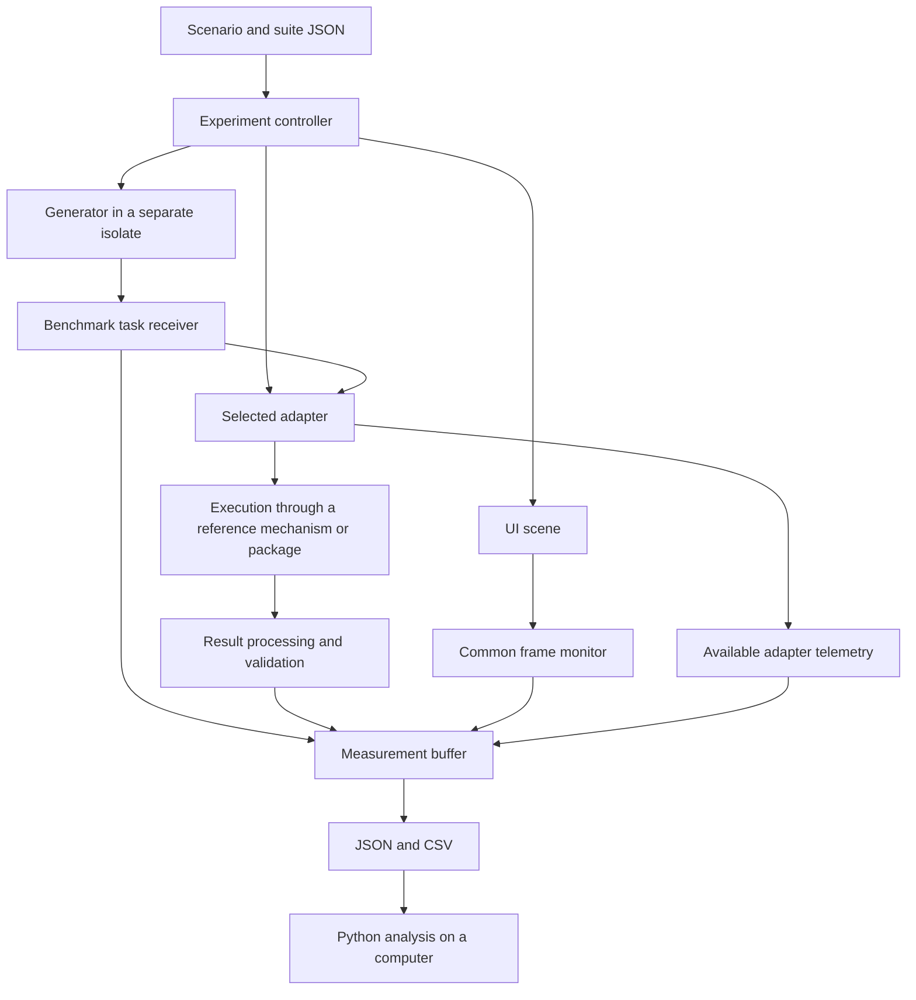

# Experimental Flutter Application Plan

Specification for review. Version dated 17 November 2026.

## 1. Deliverable for the current stage

Build a benchmark application that reproduces computational and UI workloads,
submits tasks to a selected execution implementation, collects measurements, and
exports them for comparison. Implementations are connected through adapters.

The current stage covers the experiment controller, workloads, measurements,
three simple reference executors, and the integration contract for other
implementations. The next stage will connect our package and competing packages
through this contract. Adaptive execution selection, learning, and calibration
for our future package belong to the development of that package.

The first complete deliverable runs one scenario through main, fresh, and
persistent execution, validates task results, displays a short summary, and
exports JSON/CSV. The same scenario can then be used with external adapters.

The application supports the research questions by varying task complexity,
data, arrival intensity, UI workload, and execution environment. The policy under
investigation is defined by the connected implementation.

## 2. Platforms, SDK, and technology stack

### 2.1. SDK selection

The baseline is Flutter 3.50.0 stable with its bundled Dart 3.14. As of the date
of this plan, this is the current stable release, announced on 11 November 2026.
It provides a current production version of Flutter for starting implementation.
[Release announcement](https://flutter.dev/blog/whats-new-in-flutter-3-50),
[official changelog](https://github.com/flutter/flutter/blob/stable/CHANGELOG.md).

The SDK is obtained from the 3.50.0 release archive. The same version is used
for Android and Windows. A pilot checks builds, measurement APIs, and executors.
A new SDK version forms a separate results group with control runs.
[Flutter archive](https://docs.flutter.dev/install/archive).

A PowerShell build script accepts the SDK path, checks its version, and generates
build_info.json as an application asset. It records flutter --version --machine
output, framework/engine revisions, the full Dart version, application Git commit,
buildId, architecture, build mode, and build options. Application dependencies
are pinned in a lockfile.

### 2.2. Implementation tools

| Component | Selected tools | Purpose |
| --- | --- | --- |
| Application | Flutter/Dart, standard widgets, ValueNotifier/ChangeNotifier | UI scene, controls, and experiment controller |
| Execution and clocks | dart:isolate, dart:typed_data, dart:developer | Reference executors and timestamps |
| Data and files | dart:convert, dart:io, csv 8.0.0 | JSON/CSV and result persistence |
| Directories | path_provider 2.1.6 | Configuration and result storage |
| Import and Windows export | file_selector 1.1.0 | Configuration selection and export directory selection |
| Android export | share_plus 13.3.1, archive 4.7.1 | Transfer of a results ZIP archive |
| Implementation checks | flutter_test, integration_test from the SDK | Adapter contract, task correctness, and the user launch flow |
| Frame inspection | DevTools Performance, Frame Analysis, Timeline | Individual frames and related events |
| Dart diagnostics | DevTools CPU Profiler and Memory | CPU samples, heap, allocations, and GC |
| OS diagnostics | Android Perfetto/adb, Windows WPR/WPA/PowerShell | Threads, CPU scheduling waits, and process memory |
| Desktop analysis | Python 3.13, pandas, NumPy, Matplotlib | Import, comparison of repeated runs, tables, and plots |

Selected package versions are checked by building the application during
implementation and pinned in pubspec.lock. Python uses a virtual environment
with fixed versions after checking imports and reading sample exported data.
[path_provider](https://pub.dev/packages/path_provider),
[file_selector](https://pub.dev/packages/file_selector),
[share_plus](https://pub.dev/packages/share_plus),
[archive](https://pub.dev/packages/archive),
[csv](https://pub.dev/packages/csv).

Android requires the Android SDK, adb, a JDK, and Gradle/AGP versions compatible
with the Flutter template and plugins. Windows requires Visual Studio with
Desktop development with C++, the Windows SDK, and CMake. Versions are recorded
in build metadata, and the environment is checked with flutter doctor -v.
[Android](https://docs.flutter.dev/platform-integration/android/setup),
[Windows](https://docs.flutter.dev/platform-integration/windows/setup).

### 2.3. Build modes

| Mode | Use |
| --- | --- |
| debug | Development and checking configuration, error handling, and result correctness |
| profile | DevTools diagnosis of CPU, memory, frames, and synchronous execution segments |
| release | Main measurement series on physical devices |

Native debug builds use JIT and additional checks. Profile and release use AOT
with different diagnostic capabilities. Results are grouped by SDK, buildMode,
and instrumentation settings.
[Build modes](https://docs.flutter.dev/testing/build-modes).

```sh
flutter run --debug -d <device-id>
flutter run --profile -d <device-id>
flutter build apk --release
flutter build windows --release
```

### 2.4. Dart defines

| Parameter | Default | Purpose |
| --- | --- | --- |
| BENCH_AUTORUN | false | Run the bundled suite after application preparation |
| BENCH_SUITE_ASSET | Empty string | Path to the suite JSON within the asset bundle |
| BENCH_BUILD_ID | local | Build identifier matching build_info.json |

These values are fixed at compilation and read through const
String.fromEnvironment and bool.fromEnvironment. Changing them requires a new
build. Scenarios and executor options are loaded from JSON at runtime.
[Environment declarations](https://dart.dev/libraries/core/environment-declarations).

An example build/launch_defines.json for a prepared asset follows.

```json
{
  "BENCH_AUTORUN": true,
  "BENCH_SUITE_ASSET": "assets/experiments/reference_comparison.json",
  "BENCH_BUILD_ID": "pilot-001"
}
```

```sh
flutter build apk --release --dart-define-from-file=build/launch_defines.json
```

The build script copies the selected JSON into assets. The controller validates
it and executes the suite once per process launch. All approaches in a suite
use the same binary. Define values are included in the manifest.

## 3. Configuration and controls

The main configuration is authored as JSON on a computer and stored in the
repository. The proposed structure follows.

```text
experiments/
  scenarios/
    arrival_step_up_down.json
    ui_step_up_down.json
    randomized_load.json
  suites/
    reference_comparison.json
```

A scenario contains tasks, their schedule, the UI scene, and a seed. A suite
adds adapters, their options, repetitions, and execution order. Defaults are
defined by the schema version. The fully resolved configuration is saved
before each run.

The user imports JSON through a system file picker or selects a bundled
scenario. Imported configurations are stored in the application directory for
reuse. The UI displays the description and run count. The Run button passes
the configuration to the controller. Autorun uses the same preparation and
execution path.

Validation checks fields, identifiers, ranges, phases, variant weights, and
compatibility with adapter capabilities. Errors identify the field before
measurement begins.

## 4. Architecture



| Component | Responsibility |
| --- | --- |
| Controller | Preparation, repetitions, start, stopping submissions, completion, and export |
| Task registry | Common computational functions, data, and result validation |
| Generator | Saved arrival plan and workload changes |
| Task receiver | Common timestamps and calls to the selected adapter's submit method |
| Adapter | Wrapper around an execution implementation and its API |
| UI scene | Reproducible animation and complexity phases |
| Observers | Common task/frame metrics and available additional telemetry |
| Export and analysis | Portable data, import, summaries, and comparisons |

For scheduled arrivals, the benchmark calls submit for tasks whose arrival time
has been reached while continuing to process subsequent arrivals. The adapter
or connected package manages its queues, workers, and execution admission.
This preserves the implementation's behavior during the experiment.

The generator runs in a separate isolate and records planned and actual send
times. When main is blocked, tasks may wait in its port. Common measurements
include this delay through latency relative to the planned arrival time.

## 5. Executor integration contract

The proposed interface has four operations.

```dart
abstract interface class ExecutionAdapter {
  AdapterInfo get info;
  Future<void> prepare(AdapterConfig config);
  Future<TaskResult> submit(TaskRequest task);
  Future<void> close();
}
```

The example types describe the benchmark contract. AdapterInfo contains the id,
version, supported tasks, transfer modes, and telemetry. AdapterConfig contains
executor options and initial state. TaskRequest supplies taskId, the registered
operation, its parameters, and the actual input data. TaskResult returns the
result and available execution measurements.

After the Future completes, the benchmark performs common result validation.
Each task receives one terminal status. Adapter and computation errors are
recorded with taskId. The durations of prepare, submit, and close are measured
externally through the common contract.

An adapter may report the execution context, computation start, its queue depth,
and other events. Availability is recorded for each field. Externally observed
task latency and frame measurements are collected for every implementation.

The future adapter for our package will call its public API. Adapters for other
packages serve the same role for their APIs. Package-specific observers, learning,
and rules remain part of those implementations. Options and versions are
recorded with the results of each run.

### Reference executors for the current stage

| Identifier | Behavior |
| --- | --- |
| main_direct | Synchronous invocation of the common computational kernel in the main isolate |
| fresh_isolate | A new Isolate.run for each task |
| persistent_worker | Isolate.spawn, a readiness handshake, and messaging with a persistent worker |

For initial checks, fresh and persistent allow one computation to execute at a
time. Pending tasks are tracked by the corresponding reference adapter. Main
processes incoming calls sequentially through its event loop. The limit is
configured through adapterOptions.referenceConcurrency and recorded in the manifest.

Workload controls determine the arrival rate, while adapter options determine
execution resources. When an external package is connected, supported limits
are checked through its capabilities and options. The report records actual
comparison conditions, including the availability of worker and queue information.

## 6. Tasks and workload changes

### 6.1. Computational kernels

The first version includes a minimal operation, a synthetic numerical kernel,
JSON parsing followed by processing, and byte-buffer processing. The same
function and inputs are used for all adapters supporting a scenario.

The synthetic kernel performs workUnits iterations, accumulating state that
depends on the input. It produces a verifiable result of a specified size.
Application-oriented tasks define workUnits in the registry, for example as
the number of processing passes after parsing. Input size may also change the
amount of work.

Fixtures are generated before the measurement window. Computational functions
preserve the original fixtures for repeated calls. Required working copies are
created within the measured processing path. The common receiver consumes and
validates the result.

### 6.2. Workload parameters

| Parameter | Values or unit | Purpose |
| --- | --- | --- |
| arrivalMode | periodic, burst, poisson | Arrival pattern |
| arrivalRatePerSecond | Tasks/s, starting at 0 | Rate or mean intensity |
| burstSize, burstPeriodMs | Tasks and ms | Burst size and period |
| workUnits | Integer, starting at 1 | Work per task |
| inputBytes, outputBytes | Bytes, starting at 0 | Input and result sizes supported by the kernel |
| representation | For example, uint8_list or json_string | Input representation |
| transferMode | message or transferable | Transfer variant when supported by the adapter |
| taskVariants | Complete task descriptions and weights | Mixed task stream |
| seed | Integer from 0 to 2^32 - 1 | Root of the random streams |

Scenarios include constant load, increases, decreases, low/high/low intensity,
bursts, and changes in task composition. Linear changes in the first version
apply to the periodic arrival rate. Sizes and workUnits change in steps drawn
from a specified set. Zero intensity pauses submissions.

When the rate decreases, previously submitted tasks continue to execute.
This allows recovery from overload to be measured. Outstanding work and the
intensity of new arrivals are recorded separately.

Reproducible comparisons define phases in JSON. An interactive pilot provides
controls for these parameters. Changes apply to future tasks and are recorded
with request and application times. The manifest records scripted or interactive.

## 7. UI complexity and randomness

### 7.1. Scene parameters

| Parameter | Values | Purpose |
| --- | --- | --- |
| uiMode | static, animated_grid | Scene type |
| uiElementCount | Integer, starting at 0 | Number of elements |
| uiUpdateMode | transform, layout | Transformations or geometry changes |
| uiRasterEffect | none, blur | Additional filtering |
| uiBlurSigma | Number, starting at 0 | Blur parameter |
| uiPeriodMs | Ms, greater than 0 | Motion period |
| uiRandomizeInitialState | Boolean | Initial parameters derived from seedUI |

All elements are placed in the visible grid area, with sizes adjusted to the
viewport. The transform profile animates transformations of fixed content.
The layout profile changes sizes or padding. Blur uses an explicitly bounded
area with fixed clipping and filter grouping. The manifest records viewport,
DPR, renderer, and display refresh rate.
[BackdropFilter](https://api.flutter.dev/flutter/widgets/BackdropFilter-class.html).

Pilot levels include a static scene, transform with 16/64/256 elements,
layout with 64 elements, and blur with sigma 4/8 at 64 elements. The baseline
motion period is 2000 ms. Actual costs are established through measurements.

Scenarios cover increases and decreases in element count, transform/layout/transform,
enabling and disabling blur, and spikes lasting 500/2000/10000 ms. A separate
scenario uses a pseudorandom order of allowed UI phases. The scene is first
measured with zero task intensity and then with a specified task stream.
Individual series vary one axis. Combined changes form a stress scenario.

### 7.2. Randomness

Separate generators use the following seeds modulo 2^32.

| Stream | Value | Purpose |
| --- | --- | --- |
| seedFixtures | seed | Input data |
| seedArrivals | seed + 1 | Arrival times |
| seedTasks | seed + 2 | Selection from taskVariants |
| seedUI | seed + 3 | Initial element state and the plan of random UI phases |
| seedOrder | seed + 4 | Adapter order within a block of repetitions |

For poisson with constant intensity, the interval is calculated as
deltaSeconds = -ln(1 - u) / arrivalRatePerSecond, where u is in (0, 1).
Zero intensity defines a pause. The first version's random arrival mode uses
separate phases with constant intensity.

A scenario specifies one task or a taskVariants array with nonnegative weights
and a positive total. The generator normalizes the weights. Exact task and UI
plans are created before the run. All adapters in a block receive the same
plans and data.

UI element parameters are calculated before the run. Animation state is a
function of elapsed time, period, and the saved initial phase. When randomization
is disabled, a fixed color order and zero initial phase are used.

The export includes seeds, generator version, workload_trace.csv, ui_trace.json,
and fixtures. For replay, the saved plans are included in JSON and fixtures
are supplied with it in a ZIP archive. Dart Random may change between library
versions, so the exact plan and data are part of the reproducibility bundle.
[Dart Random](https://api.dart.dev/dart-math/Random/Random.html).

The proposed random pilot uses seeds 42, 73, and 101 with five repetitions each.
Data is analyzed using matching scenarios and complete runs.

## 8. Example configuration

This single-run example increases and decreases the arrival rate while keeping
the remaining parameters fixed. WorkUnits and rates are refined during the pilot.

```json
{
  "schemaVersion": 1,
  "runMode": "scripted",
  "scenarioId": "arrival_step_up_down_v1",
  "seed": 42,
  "adapter": "fresh_isolate",
  "adapterOptions": {"referenceConcurrency": 1},
  "arrivalMode": "periodic",
  "task": {
    "taskType": "synthetic_numeric",
    "workUnits": 100000,
    "inputBytes": 16384,
    "outputBytes": 64,
    "representation": "uint8_list",
    "transferMode": "message"
  },
  "ui": {
    "uiMode": "animated_grid",
    "uiElementCount": 64,
    "uiUpdateMode": "transform",
    "uiRasterEffect": "none",
    "uiBlurSigma": 0,
    "uiPeriodMs": 2000,
    "uiRandomizeInitialState": true
  },
  "phases": [
    {"durationMs": 10000, "arrivalRatePerSecond": 5},
    {"durationMs": 10000, "arrivalRatePerSecond": 30},
    {"durationMs": 10000, "arrivalRatePerSecond": 5}
  ]
}
```

A phase's ui object partially overrides the scene state. Unspecified values
are inherited. For example, uiElementCount values of 16/256/16 at a constant
arrival rate test changing animation load. Fully resolved phase states are
saved in resolved_config.json, and actual changes are saved in load_events.csv.

A suite file contains scenario, adapters with their options, seeds, repetitions,
and an ordering rule. The controller expands it into individual runs. Each run
receives a runId and a configuration snapshot. The suite format is validated
under the same schema version.

## 9. Protocol and initialization

A run progresses through Preparing, WarmingUp, Running, Draining, Finalizing,
and Completed. Interruptions receive Cancelled or Failed with a reason.

1. Read and validate the configuration, then prepare fixtures and plans.
2. Prepare the selected adapter and UI scene.
3. Record the start time and submit tasks according to the plan.
4. Stop submissions and await results within the drain timeout.
5. Collect remaining frame reports, close the adapter, and check counters.
6. Save files and display a short summary.

| Stage | Accounting |
| --- | --- |
| Build, installation, process launch, and engine startup | Environment information and build metadata |
| Data, generator, and UI preparation | Separate durations in setup.json |
| Adapter prepare | Separate duration and a description of created resources |
| Warm persistent reference | Creation and handshake before the common start timestamp, with costs saved separately |
| Cold persistent reference | Creation on the first task, included in its latency |
| Fresh reference | Isolate creation included in every task's latency |
| Message preparation and result processing | Part of task latency, with separate timestamps where available |
| Queue draining | Final task latencies and drain duration |
| close and export | Separate finalization durations |

For the persistent reference, adapterOptions.workerStartMode selects warm or
cold. External adapters document their prepare behavior and supported initial
states. The default UI warmup phase is 2000 ms. Initial resource state is
restored between repetitions according to the configuration.

Minimal single-task measurements use closed_loop, where the next task is
submitted after the previous one completes. Scenarios with a specified arrival
intensity use open_loop and a previously generated arrival plan.

The maxOutstandingTasks limit covers all submitted tasks without a terminal
result, including those waiting in the main port. At the limit, the generator
records overload and stops submissions. The full planned stream and the
actually sent prefix are saved.

Initial pilot settings follow.

| Parameter | Value |
| --- | --- |
| referenceConcurrency | 1 |
| uiWarmupMs | 2000 |
| maxOutstandingTasks | 10 000 |
| drainTimeoutMs | 60 000 |
| frameReportWaitMs | 2500 |
| pilotRepetitions | 5 |

Each task has one terminal status of completed, failed, cancelled, or unfinished.
Duplicate result delivery is handled by taskId. Executor failure records a run
error, stops submissions, and preserves available results. Task conditions and
outcomes are retained for all completion paths supported by the adapter.

## 10. Common metrics and diagnostics

### 10.1. Tasks and clocks

All adapters record plannedSubmitUs, producerSendUs, receivedUs, submitStartUs,
submitReturnUs, resultReceivedUs, and completedUs after validation. Internal
computeStartUs/computeEndUs, execution context, and queue depth are added when
available, with their source identified.

Overall latency is completedUs - plannedSubmitUs. Latency after receipt is
completedUs - receivedUs. The synchronous duration of the submit call is also
recorded. Waiting inside a package is measured when telemetry is available.

Outputs include P50/P95 latency, completions and errors, throughput, outstanding
work, and recovery time after the load decreases. P99 is reported with a
sufficient observation count. The unit of comparison is a complete run.

Dart events use Timeline.now, with cross-isolate clock comparability checked
on each target configuration. Raw FrameTiming timestamps and clock correlation
are saved separately. The pilot checks their relationship before time-series
analysis.
[Timeline.now](https://api.dart.dev/dart-developer/Timeline/now.html),
[FrameTiming timestamps](https://api.flutter.dev/flutter/dart-ui/FrameTiming/timestampInMicroseconds.html).

### 10.2. Frames

The common monitor uses addTimingsCallback to record buildDuration,
rasterDuration, vsyncOverhead, totalSpan, raw timestamps, and delivery time.
For continuous animation, intervals between reported frames are calculated
using the preceding frame beyond the window boundary when needed. Frame counts
and the fractions exceeding stage budgets are recorded. The budget is derived
from the recorded display refresh rate.

Reports arrive in batches, approximately once per second in release mode.
They are assigned to measurement phases by frame time, with clock-correlation
uncertainty recorded. Collection at the end of the run accounts for late reports.
[addTimingsCallback](https://api.flutter.dev/flutter/scheduler/SchedulerBinding/addTimingsCallback.html).

### 10.3. Inspection tools

| Subject | Tool | Artifact |
| --- | --- | --- |
| Individual frames, UI/raster, and related events | DevTools Performance, Frame Analysis, Timeline in profile | Exported tool snapshot |
| Dart functions and CPU samples | DevTools CPU Profiler for available isolates on Android | CPU profile |
| Dart heap, allocations, and GC | DevTools Memory in profile | Profiles and memory snapshots |
| Android threads and CPU scheduling waits | Perfetto in a diagnostic run | System trace |
| Windows threads and CPU activity | WPR/WPA | ETL trace |
| Android process memory | adb shell dumpsys meminfo | PSS and original command output |
| Windows process memory | PowerShell/System.Diagnostics.Process | WorkingSet64 and PrivateMemorySize64 by PID |
| Repeated-run comparisons and plots | Python/pandas/NumPy/Matplotlib | Tables, figures, and report.md |

Profile runs annotate submit, computation, and result processing with runId/taskId
where supported by the adapter. DevTools view availability is checked in the
pilot. Main release runs use common measurements collected by the application.
[Performance](https://docs.flutter.dev/tools/devtools/performance),
[CPU Profiler](https://docs.flutter.dev/tools/devtools/cpu-profiler),
[Memory](https://docs.flutter.dev/tools/devtools/memory).

External diagnostics use separate repetitions of selected scenarios. The
initial memory polling interval is 2000 ms. Actual polling times and their
impact in a control pair are recorded. Process memory comparisons use the
same definitions and tool within an OS configuration.
[Perfetto](https://perfetto.dev/docs/quickstart/android-tracing),
[WPR/WPA](https://learn.microsoft.com/en-us/windows-hardware/test/wpt/windows-performance-recorder),
[Android dumpsys](https://developer.android.com/tools/dumpsys).

## 11. Results and data flow

```text
Flutter and the selected adapter
    -> common observation buffer
    -> JSON/CSV on the device
    -> directory or ZIP transferred to a computer
    -> results/raw/<seriesId>/<runId>/
    -> Python analysis
    -> results/analysis/<analysisId>/
```

On the device, storage uses getApplicationDocumentsDirectory() with
adaptive_flutter_scheduler/runs/<seriesId>/<runId>/ appended. The application
displays the full path. Imported configurations are stored in the adjacent
configs directory. Windows copies a run to the selected directory. Android
transfers a ZIP archive through the system share dialog. Original files are
retained for repeated export.
[path_provider](https://pub.dev/documentation/path_provider/latest/path_provider/getApplicationDocumentsDirectory.html).

| File | Contents |
| --- | --- |
| manifest.json | Schema, runId, build, device, OS, viewport/DPR, renderer, refresh rate, tools, and terminal status |
| adapter_info.json | Adapter identifier, version, options, capabilities, and initial state |
| source_config.json | Original scenario or suite JSON |
| resolved_config.json | All applied settings for the individual run |
| setup.json | Data and UI preparation, prepare/close, and finalization |
| tasks.csv | Parameters, common timestamps, available internal measurements, and task statuses |
| frames.csv | Frame measurements and delivery time |
| load_events.csv | Phases and actual application of manual changes |
| workload_trace.csv | All planned tasks and their arrival times |
| ui_trace.json | UI phases and initial element parameters |
| fixtures/ | Input data used for replay |
| adapter_events.jsonl | Additional events provided by the adapter |
| summary.json | Summary and completion counters |

Events are buffered during measurement, and files are written during
finalization. The manifest starts with running status and later receives the
terminal status, file list, field availability, and record counts. Buffer
overflow or interrupted finalization is marked as incomplete data. Each runId
is unique.

JSON/CSV use UTF-8. CSV uses commas as separators and decimal points in numbers.
Task result records contain validation, size, and a check value. The result
object is released after common processing.

On the computer, Python checks schemaVersion, completeness, and counters.
Repeated imports of the same runId are checked for data consistency. The
directory structure follows.

```text
results/
  raw/<seriesId>/<runId>/
  diagnostics/<runId>/
  analysis/<analysisId>/
    analysis_manifest.json
    tables/
    figures/
    report.md
```

Diagnostics contain original snapshots and traces, system_metrics.csv, and
diagnostics_manifest.json with the tool, version, PID, build mode, settings,
and time boundaries. Analysis records its input runIds, script version, and
parameters. The report accounts for errors and incomplete runs.

## 12. UI and user workflow

- The scenario screen selects bundled or imported JSON and displays parameters,
  adapters, and repetition counts. The controller receives the launch request.
- The interactive pilot provides workload controls and a change log. Actual
  application times are recorded, including delays in main event processing.
- The measurement scene follows the saved plan. Diagnostic UI updates follow
  the same rule across compared runs.
- The results screen displays status, completion counts, errors, main task/frame
  metrics, file location, and export controls.

Python on the computer produces detailed time series, repeated-run comparisons,
and plots. UI and autorun share one controller. Control widgets pass settings,
while the generator and adapter operate through programmatic interfaces.

## 13. Implementation stages and acceptance

| Stage | Verifiable deliverable |
| --- | --- |
| 1. Environment | Pinned SDK, build metadata, debug/profile/release, and a target-platform build |
| 2. Scenarios and workloads | JSON, validation, phases, seeds, plans, and load increases/decreases |
| 3. Contract and reference executors | prepare/submit/close, main/fresh/persistent, and correct results |
| 4. Measurements | Common boundaries, validated clocks, frames, errors, and monitoring overhead |
| 5. Suites and export | Repetitions, ordering, state restoration, complete files, and desktop import |
| 6. Complete benchmark | UI/autorun, randomized and UI scenarios, a Python report, and a check of additional adapter integration |

Acceptance of the first version uses the following observable outcomes.

- A scenario authored on a computer can be imported, validated, and expanded into the expected runs.
- Increases and decreases in arrivals, computation, data, and UI are reflected in plans and events.
- Reference executors return identical, correct results.
- Open-loop preserves the specified plan independently of execution speed and records backlog.
- All compared adapters in a block use matching plans and fixtures.
- UI complexity changes, random arrivals, and time-based animation are verified.
- Repetitions use matching SDK/buildMode and restored initial state.
- Warm/cold and fresh costs follow the declared measurement boundaries.
- Submitted-task counters reconcile with terminal statuses and outstanding work.
- An adapter with limited telemetry retains common task/frame metrics and field availability information.
- Adapter replacement uses the registry and common contract while preserving the generator, UI, and export.
- UI and BENCH_AUTORUN follow the same launch path.
- Exported data can be imported into results/raw, diagnostics are linked to runId, and Python produces a report.

The limits, UI levels, task selection, and repetition counts above are initial
proposals for the benchmark pilot. Its measurements will refine the protocol.

## Related materials

- [Research scope and literature review](chapters.tex).
- [Flutter isolate mechanisms](https://docs.flutter.dev/perf/isolates).
- [TransferableTypedData](https://api.dart.dev/dart-isolate/TransferableTypedData-class.html).
